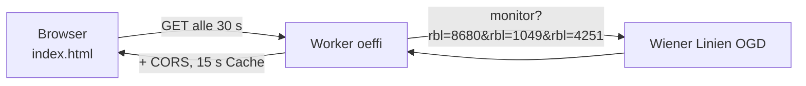

# oeffi – Abfahrten der Wiener Linien

Schlanke Webseite mit den nächsten Abfahrten für drei feste Verbindungen:

- 98A, Hoechlegasse, Richtung Aspernstraße U (RBL 8680)
- 26A, Lohwaggasse, Richtung Kagran U (RBL 1049)
- U2, Aspernstraße, Richtung Karlsplatz (RBL 4251)

Live: <https://abfahrt.aininger.com>

## Auf einen Blick

| | |
|---|---|
| Frontend | statisch, `index.html`, GitHub Pages, Domain per `CNAME` |
| Backend | Cloudflare Worker `oeffi` (`worker.js`) |
| Worker-URL | `https://oeffi.mario-aininger.workers.dev` |
| Externe Quelle | Wiener Linien OGD Realtime (`www.wienerlinien.at/ogd_realtime/monitor`) |
| Secrets | keine (der Worker hat bei Cloudflare keine Secrets oder Bindings) |
| Speicher | nur Browser (`localStorage`, Schlüssel `oeffi-ansicht` = gewählte Ansicht) |

## Datenfluss

- Der Browser fragt den Worker alle 30 Sekunden (nur bei sichtbarem Tab). Die Restzeit rechnet die Seite jede Sekunde selbst nach.
- Der Worker reicht nur die drei fest eingetragenen Steige weiter. Er ist also kein offener Weiterleiter für andere Abfragen.
- Der Worker setzt die CORS-Freigabe, die die Wiener Linien selbst nicht senden, und cacht 15 Sekunden.
- `ALLOWED_ORIGINS` im Worker: `https://marioaininger-bot.github.io` und `https://abfahrt.aininger.com`.

## Ansichten

Drei Darstellungen, umschaltbar und im Browser gemerkt: `hell` (Standard), `tafel` (Anzeigetafel-Stil) und `modern`.

## Verbindung ändern oder ergänzen

Die RBL-Nummern stehen an **zwei Stellen** und müssen übereinstimmen:

1. `worker.js` → `RBLS`
2. `index.html` → `CONNS` (mit Linie, Haltestelle, Richtung und Farben)

Danach den Worker neu deployen.

## Einrichtung / Deployment

Im Repo gibt es **kein `wrangler.toml`**, der Worker `oeffi` wird nicht per Wrangler aus diesem Repo gebaut. Der Inhalt von `worker.js` muss bei Änderungen deshalb von Hand in den Worker übernommen werden:

1. Cloudflare → Workers & Pages → Worker `oeffi` → Code bearbeiten → Inhalt von `worker.js` einfügen → Deploy.
2. Die Worker-Adresse steht in `index.html` bei `URL_API`.
3. GitHub Pages: Branch `main`, Ordner `/`.
4. Neue Domain für die Seite? In `worker.js` bei `ALLOWED_ORIGINS` eintragen.

## Fallstricke

- **Zwei Listen:** Stimmen `RBLS` (Worker) und `CONNS` (Seite) nicht überein, fehlen Abfahrten oder die Seite zeigt Lücken.
- **Worker und Repo können auseinanderlaufen**, weil es keinen automatischen Deploy gibt. Nach jeder Änderung an `worker.js` bewusst neu deployen.
- **CORS:** Blockt der Browser die Antwort, fehlt meist die Seiten-Domain in `ALLOWED_ORIGINS`.
- **Wiener Linien nicht erreichbar:** Der Worker antwortet mit HTTP 502, die Seite zeigt dann einen Fehler.
- Die Daten sind Echtzeit-Prognosen und können abweichen.
